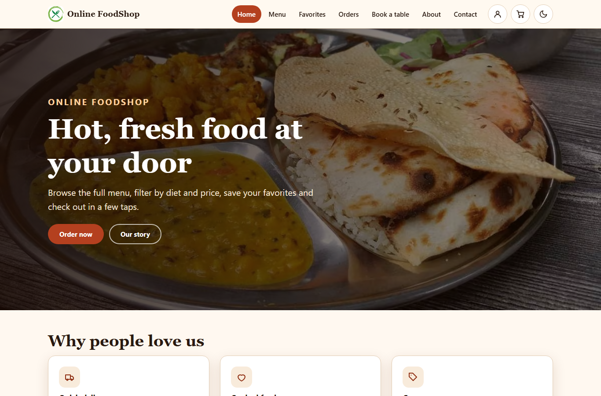
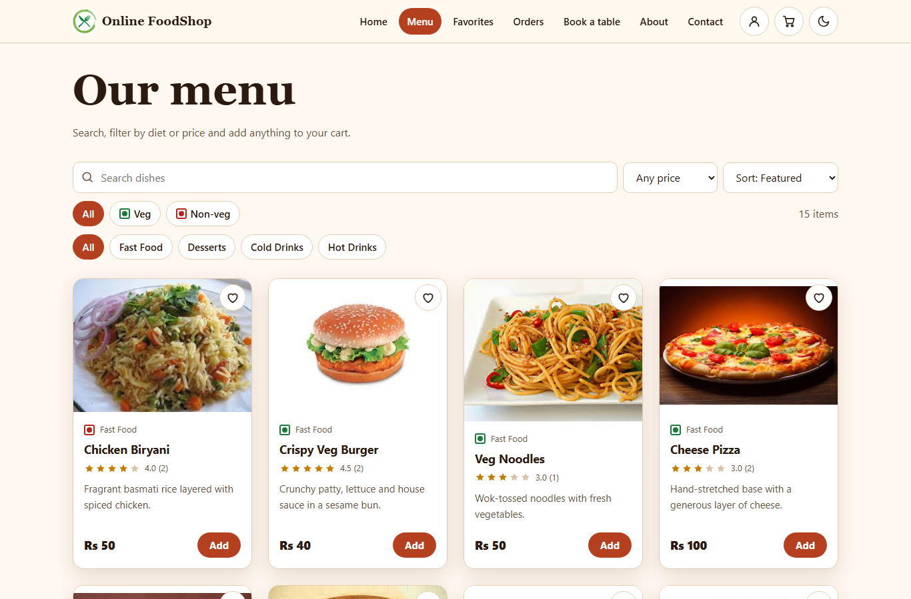
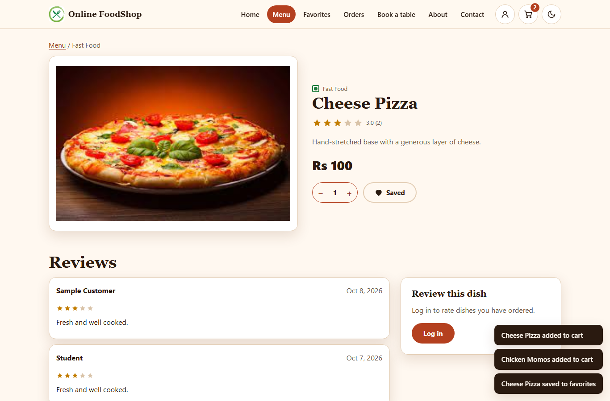
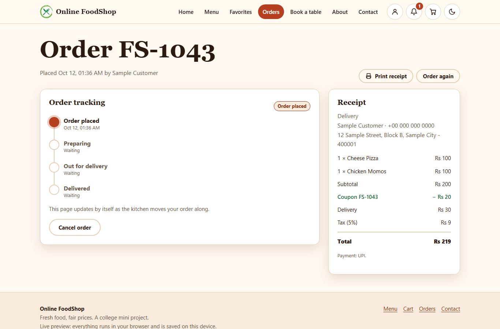
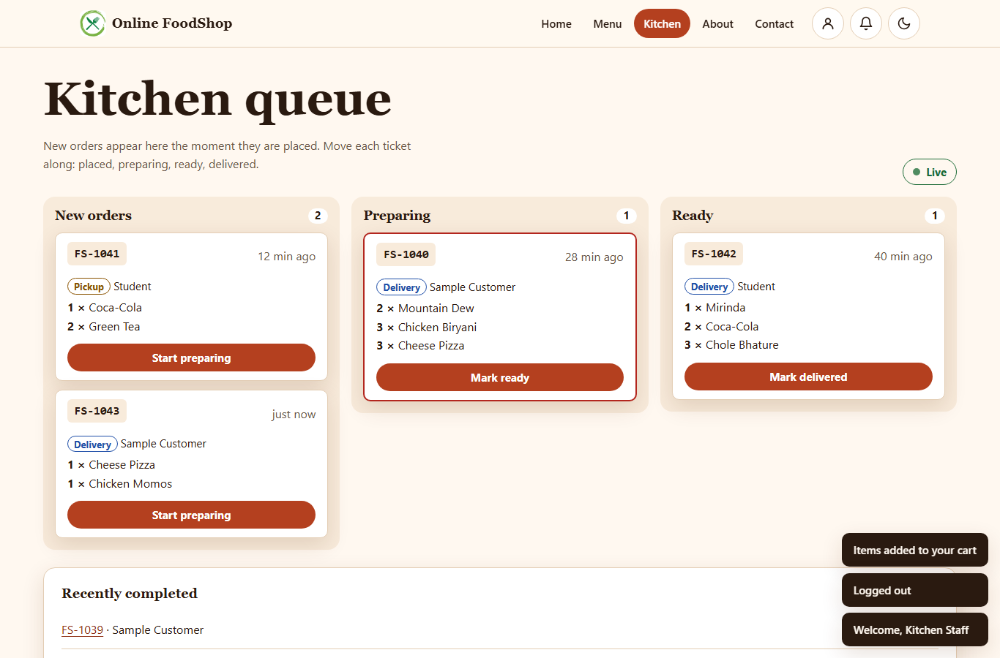
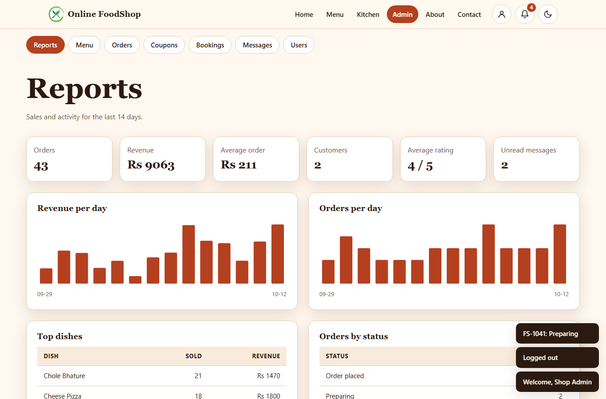
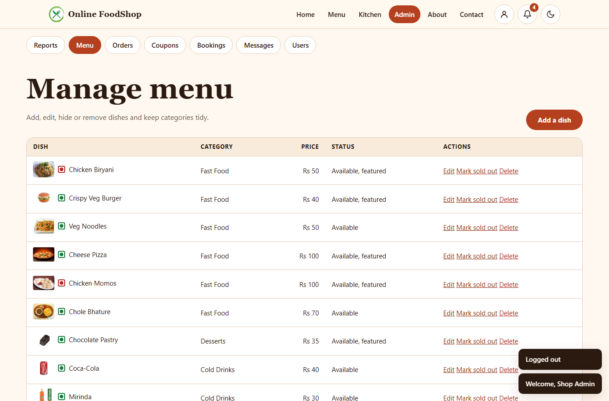
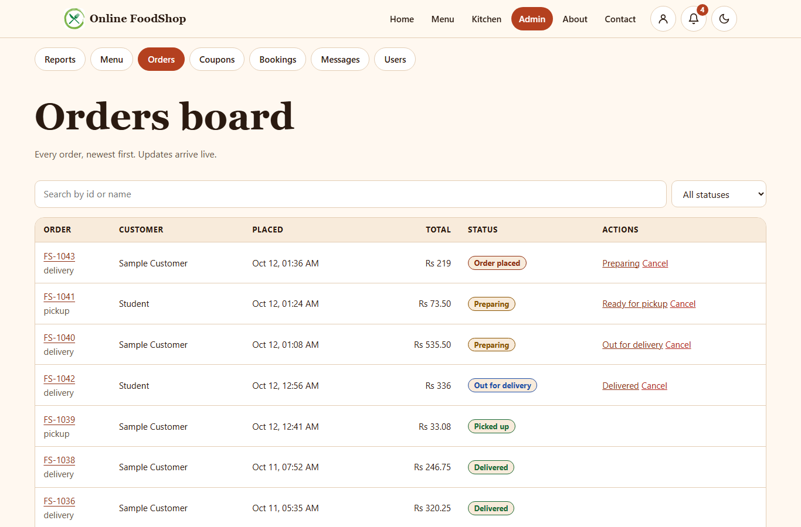
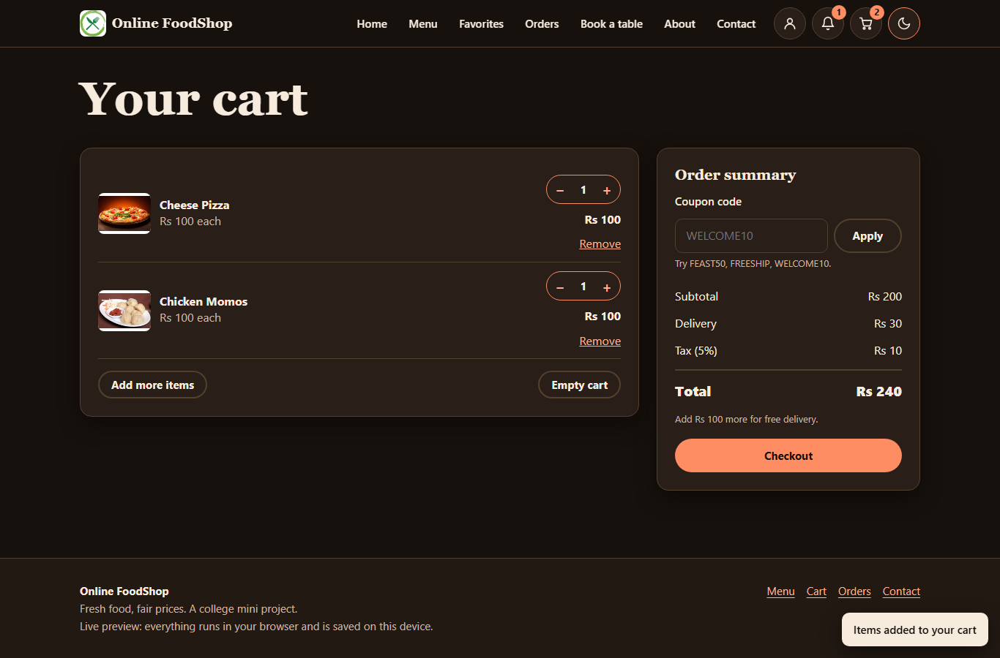
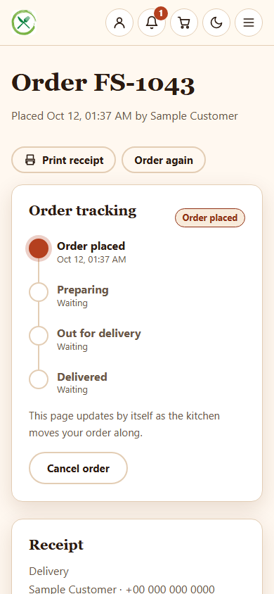

# College Mini Project - Online FoodShop (MERN)

A food-ordering app rebuilt as a proper full-stack project: **MongoDB + Mongoose, Express 5, React 19 (Vite) and Node 24**. It started as a static college mini project (menu, filters, cart, coupons, checkout, orders, favorites, login, contact, about, dark mode, parallax). The look, branding, photos, menu and flows of that site are kept; the app now has real accounts, roles, a live kitchen queue and an admin area.

**Live preview:** https://shishir19999.github.io/College-Mini-Project/

GitHub Pages is static hosting, so it cannot run the API or MongoDB. The Live preview therefore runs the very same UI against an in-browser backend: the same routes, roles, validation and pricing rules from [`shared/`](shared), with the sample data kept in your browser (localStorage) and live order updates passed between tabs. In the normal build the same UI talks to Express + MongoDB, and the kitchen queue updates through Socket.IO.

> Live preview: everything runs in your browser with sample data. Changes stay on this device. Use the "Sample accounts" box on the login page to try each role.

## Screenshots

| | |
|---|---|
|  <br> Home: parallax hero, carousel, popular dishes |  <br> Menu: search, diet, price, category and sort |
|  <br> Dish page with ratings and reviews |  <br> Order tracking timeline and receipt |
|  <br> Kitchen staff: live order queue |  <br> Admin: reports |
|  <br> Admin: menu management with image upload |  <br> Admin: orders board |
|  <br> Dark theme |  <br> Phone layout (320px and up) |

## Roles

Three roles with one rule set, enforced in the shared route table (`shared/routes.js`) on the server and in the Live preview. New sign-ups are always customers; an admin can change roles on the Users page.

| Role | Home screen | What they can do |
|---|---|---|
| Customer (or guest browsing) | Home / Menu | Browse and search the menu, favorites, cart and coupons, checkout (delivery or pickup with a time slot), order history, live order tracking, reorder, cancel while still "placed", printable receipt, rate dishes after receiving them, saved addresses, table booking, notifications, contact form |
| Kitchen staff | Kitchen queue | Live board of new / preparing / ready orders, move a ticket one step: placed, preparing, ready, delivered. Staff do not place orders |
| Admin | Reports | Everything kitchen staff can do, plus: menu CRUD with image upload and categories, coupons, all orders with status control and cancel, table bookings, contact inbox, users (role and enable/disable), sales reports |

### Sample accounts (for trying the app only)

| Role | Email | Password |
|---|---|---|
| Customer | `demo@example.com` | `Demo@1234` |
| Customer | `student@example.com` | `Student@123` |
| Kitchen staff | `kitchen@foodshop.example` | `Kitchen@123` |
| Admin | `admin@foodshop.example` | `Admin@123` |

These exist only in the seeded sample data (the seed script and the Live preview). Change or remove them before exposing a real deployment. Contact details on the contact page are placeholders.

## Features

- **Menu**: the original 15 dishes in 4 categories with photos, veg / non-veg marks, search, price filter, sort (featured, top rated, price, name), category tabs, dish pages, sold-out handling.
- **Cart and coupons**: steppers, `WELCOME10` (10% off), `FEAST50` (Rs 50 off above Rs 250), `FREESHIP` (free delivery), delivery fee Rs 30 (free above Rs 300 or for pickup), 5% tax. Admin can add and edit coupons (percent, flat, free delivery, minimum, expiry, on/off).
- **Checkout**: details, payment (simulated, nothing stored), review; saved addresses; pickup in about 15 minutes or a chosen 30-minute slot with capacity limits.
- **Orders**: history, tracking page with a timeline (placed, preparing, ready or out for delivery, delivered), live updates, reorder, cancel, print receipt.
- **Kitchen queue**: live board (Socket.IO against the API; a BroadcastChannel in the Live preview), late-order highlight, announcements for screen readers.
- **Ratings and reviews** per dish (only after a delivered order), average rating on cards and sorting.
- **Favorites**: saved on the account; guests keep them in the browser and they merge on login.
- **Table booking** with free-table counts per slot; admins manage bookings.
- **Notifications** (bell with unread count): order updates for customers, new orders / bookings / messages for admins.
- **Contact form** stored in an admin inbox (read / unread / delete). Optional email forward over Gmail SMTP (see below).
- **Admin reports**: orders, revenue, average order, customers, rating, revenue and orders per day, top dishes, status split, coupon use.
- **Interface**: light and dark theme (follows the system, remembered), parallax hero and scroll reveal (off for reduced motion, small screens and low-power devices), responsive from 320px, skip link, visible focus, keyboard-friendly tabs and carousel, accessible dialogs, loading / empty / error states. Axe checks are clean on every page for each role (desktop, phone and 320px).
- **Images**: AVIF / WebP with JPEG fallbacks for the hero and gallery (`Frontend/public/img`), dish photos in `Frontend/public/food`; other original images and `PROJECT PPT.pptx` stay in the project root.

## Stack and layout

| Part | Tech |
|---|---|
| `Backend/` | Node 24, Express 5, Mongoose 9, JWT (bcrypt-hashed passwords, token revocation on logout / password change), Socket.IO, Nodemailer (optional), rate limiting, image uploads |
| `Frontend/` | React 19, React Router 7, Vite 8, plain CSS (the original design system) |
| `shared/` | Framework-free code used by both: pricing and status rules (`rules.js`), validation, all routes (`routes.js`), request engine, in-memory store, seed data, in-browser server (`demoServer.js`) |

```
Backend/    Express app, Mongoose models, Mongo store, seed script, tests
Frontend/   React app (pages, components, contexts, in-browser API client)
shared/     rules, routes, seed data, in-browser server, tests
docs/       screenshots
```

## How to run

Requirements: Node 24+, MongoDB (local or Docker).

```
npm run install:all                 # root tools, Backend and Frontend
cp Backend/.env.example Backend/.env    # set JWT_SECRET (and MONGODB_URL if needed)
npm run seed                        # loads the sample shop into an empty database
npm run dev                         # API on :8080 and the app on http://localhost:5173
```

`npm run seed -- --reset` empties only the FoodShop collections (`fs_*`) before seeding. The seed script never drops a database.

**Live preview locally** (no backend, no MongoDB): `npm run preview:live`. **GitHub Pages build**: `npm run build:pages` (base path `/College-Mini-Project/`, hash routing).

**Docker**: copy `.env.example` to `.env`, set `JWT_SECRET`, then `docker compose up --build` and `docker compose run --rm backend node scripts/seed.js`. The app is on http://localhost:8081.

### Configuration (`Backend/.env`)

| Variable | Purpose |
|---|---|
| `MONGODB_URL`, `PORT`, `HOST` | Database and listener |
| `JWT_SECRET`, `JWT_EXPIRE` | Token signing (required) |
| `CORS_ORIGIN` | Allowed browser origins (comma separated; unset allows any) |
| `UPLOAD_DIR` | Where dish images are stored (default `Backend/uploads`) |
| `RATE_LIMIT_PER_MINUTE`, `LOGIN_MAX_FAILURES` | Request and failed-login limits |
| `SMTP_HOST`, `SMTP_PORT`, `SMTP_USER`, `SMTP_PASS`, `SMTP_FROM`, `CONTACT_TO` | Optional contact-form email over Gmail SMTP |

**Contact email (optional)**: set `SMTP_HOST=smtp.gmail.com`, `SMTP_PORT=587`, the sending account in `SMTP_USER`, a Gmail **app password** in `SMTP_PASS`, and the recipient in `CONTACT_TO`. If any of these is blank, messages are only kept in the admin inbox. Nothing is sent from the Live preview.

## Tests and checks

```
npm test              # Backend (API on a throwaway database) + shared + Frontend tests
npm run lint
npm run build && npm run build:pages
```

- Backend tests run the shared scenario against Express + MongoDB in a throwaway database named `cm_test_<pid>` that is dropped afterwards, check image uploads, errors and Socket.IO events, and run the same scenario against the in-browser server so both stay identical.
- Frontend tests cover helpers and the Live preview server.

## API in short

Everything lives under `/api` (see `shared/routes.js`): `auth/*`, `menu`, `coupons`, `quote`, `orders` (+ `/:id`, `/:id/cancel`, `/:id/status`), `kitchen/orders`, `slots`, `bookings`, `favorites`, `addresses`, `dishes/:id/reviews`, `notifications`, `contact`, and `admin/*` (dishes, categories, coupons, orders, users, messages, bookings, reports). Socket.IO connects at `/api/socket.io` with the JWT and emits `order:new`, `order:update` and `notification`.
